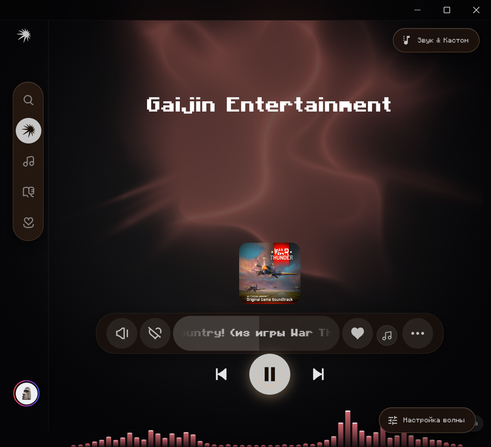
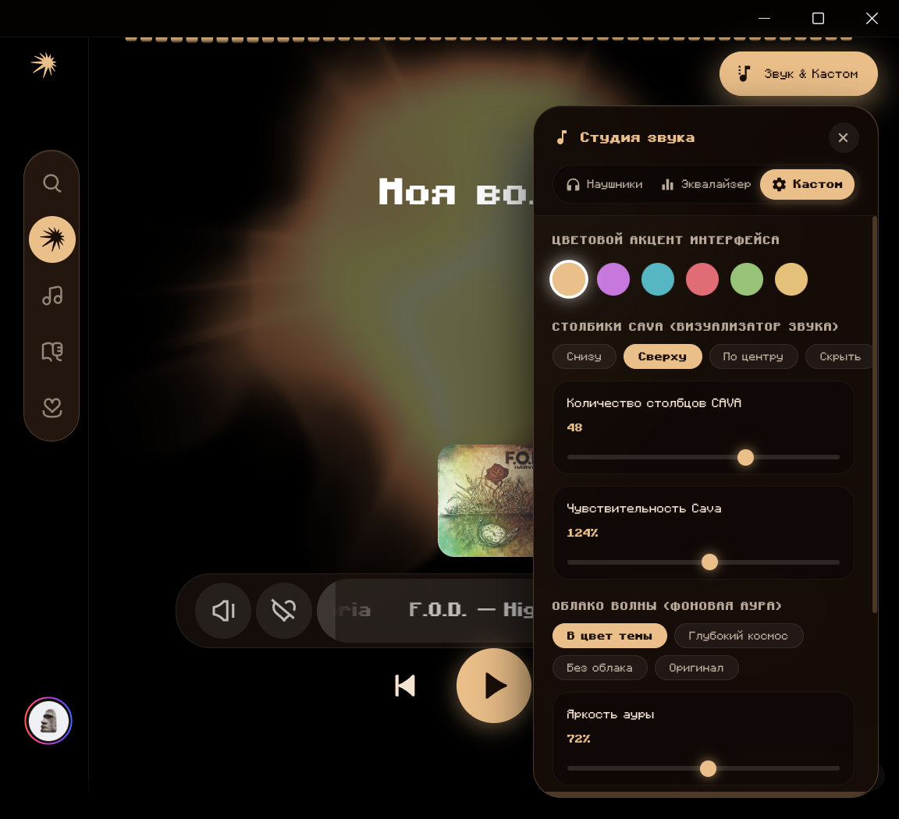
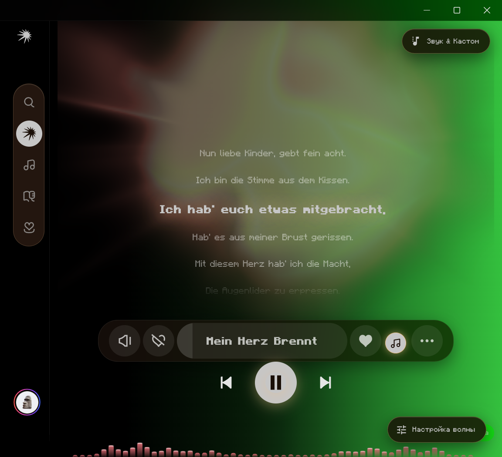
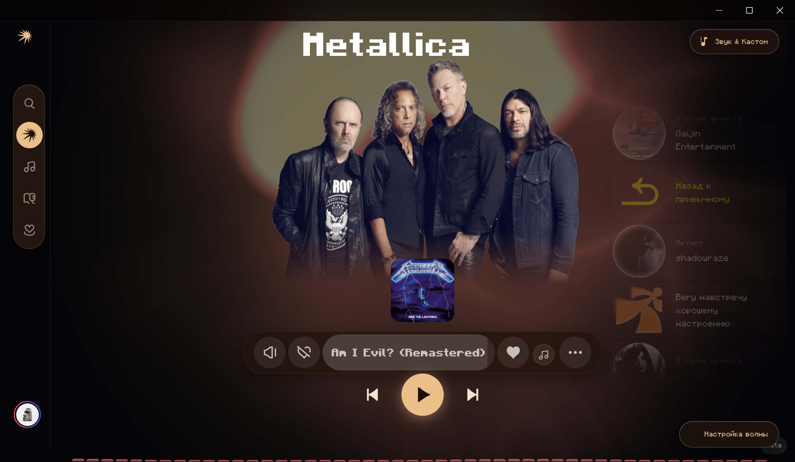

# ✨ Yandex Music Enhancer

> **Премиум-модификация для десктопного приложения Яндекс Музыка**  
> Глубокий глассморфизм, встроенная аудио-студия (10-полосный эквалайзер, предусилитель), крутящаяся виниловая пластинка, спектральный анализатор CAVA и невесомый синхронизированный текст песен.

---

## 📸 Галерея интерфейса

| Моя Волна (Glassmorphism & CAVA) | Аудио Студия & Эквалайзер |
|:---:|:---:|
|  |  |

| Невесомый текст песен | Настройка Моей Волны (Glass Drawer) |
|:---:|:---:|
|  |  |

---

## ⚡ Ключевые возможности

- 🎨 **Ультра-минималистичный Глассморфизм**:
  - Полное избавление от непрозрачных прямоугольных плашек.
  - Мягкое матовое стекло (`backdrop-filter`) для карточек, списков очередей и боковой панели.
  - Динамическая подстройка цвета ауры и акцентов под выбранную тему оформления.
- 🎛️ **Audio Studio Hub**:
  - **10-полосный студийный эквалайзер** с настраиваемыми пресетами (Bass Boost, Vocal, Acoustic, Flat и др.).
  - **Предусилитель (Preamp)** для увеличения громкости тихих записей.
  - **Интерактивная кривая частот** с плавным перетаскиванием и живой анимацией.
- 📻 **Виниловый проигрыватель**:
  - Крутящаяся пластинка с виниловыми дорожками, коническими бликами и центральной наклейкой текущего альбома.
  - Механический тонарм (игла), автоматически опускающийся при воспроизведении и поднимающийся на паузе.
- 🌊 **Спектральный анализатор CAVA**:
  - 64-полосный живой спектрограф на базе CAVA (PulseAudio / PipeWire на Linux).
  - Выбор расположения: снизу, сверху или по центру.
  - Автоматический высокоточный процедурный спектральный рендер на Windows при отсутствии CAVA.
- 📜 **Невесомый текст песен (Karaoke Lyrics)**:
  - Парящий текст прямо на месте обложки без тяжелых черных панелей.
  - Автоматическое скрытие при переходе на вкладку «Коллекция» или открытии полноэкранного режима (без наложений и утечек).
- 🎚️ **Капсула настройки волны**:
  - Компактная плавающая кнопка в правом нижнем углу.
  - Полупрозрачная карусель жанров и настроений с мгновенным откликом (60 FPS, аппаратное GPU-ускорение).

---

## 📋 Предварительные требования

Перед установкой модификации убедитесь, что на компьютере установлены:

1. **Официальное приложение Яндекс Музыка (Desktop)**:
   - **Windows:** [Скачать с официального сайта](https://music.yandex.ru/download) или установить из Microsoft Store.
   - **Linux:** Установить через пакетный менеджер (AUR: `yay -S yandex-music-electron`, Deb-пакет или Flatpak).
2. **Среда Node.js** (версия 18+):
   - **Windows:** Скачать установщик с [nodejs.org](https://nodejs.org) (рекомендуется версия **LTS**) или в терминале: `winget install OpenJS.NodeJS`
   - **Linux:** `sudo pacman -S nodejs npm` / `sudo apt install nodejs npm`

---

## 🚀 Пошаговая установка

### 🪟 Windows (Установка с нуля)

1. **Скачайте проект:**
   - Нажмите зеленую кнопку **`< > Code`** вверху этой страницы и выберите **`Download ZIP`**.
2. **Распакуйте архив:**
   - Кликните правой кнопкой мыши по скачанному архиву `YandexMusic_custom-main.zip` ➔ **«Извлечь всё...»**.
3. **Запустите установщик:**
   - Откройте распакованную папку и **дважды кликните по файлу `install.bat`**.
   - *(Или запустите PowerShell в этой папке: `powershell -ExecutionPolicy Bypass -File install.ps1`).*
4. **Готово!**
   - Патчер автоматически найдет `app.asar` Яндекс Музыки, сохранит резервную копию `app.asar.orig`, внедрит мод и создаст файлы темы.
   - Запустите Яндекс Музыку и наслаждайтесь!

---

### 🐧 Linux / macOS

1. Склонируйте репозиторий и перейдите в папку:
   ```bash
   git clone https://github.com/ivansedlyar0-star/YandexMusic_custom.git
   cd YandexMusic_custom
   ```
2. *(Опционально)* Для работы системного спектрографа установите CAVA:
   - Arch Linux / CachyOS: `sudo pacman -S cava`
   - Ubuntu / Debian: `sudo apt install cava`
   - Fedora: `sudo dnf install cava`
3. Запустите скрипт установки:
   ```bash
   ./install.sh
   ```
   *(Патчер автоматически сделает бэкап и установит все компоненты).*

---

## ⚙️ Кастомизация темы

Все пользовательские файлы хранятся отдельно от приложения и не затираются при обновлении самого патчера:
- **Linux:** `~/.config/YandexMusic/`
- **Windows:** `%APPDATA%\YandexMusic\`

### Файлы конфигурации:
1. `theme.json` — настройка шрифта и палитры цветов:
   ```json
   {
     "theme": "custom-gold",
     "font": "YS Text, sans-serif",
     "colors": {
       "primary": "#ebbf89",
       "primaryHover": "#f2cf9e",
       "text": "#f4e3d1",
       "background": "050301",
       "surface": "0a0603"
     }
   }
   ```
2. `custom.css` — полный доступ к CSS правилам с **Live Reload** (сохраните файл в редакторе, и стили в плеере обновятся мгновенно без перезапуска!).
3. Поддержка Linux тем: если у вас установлена утилита **Pywal** или окружение **Caelestia**, цвета подтягиваются автоматически.

---

## 🔄 Удаление (Откат к оригиналу)

Если вы захотите вернуть стандартный плеер, запустите:
- **Linux / macOS:**
  ```bash
  ./uninstall.sh
  ```
- **Windows:**
  ```powershell
  powershell -ExecutionPolicy Bypass -File uninstall.ps1
  ```
Оригинальный нетронутый файл `app.asar.orig` будет мгновенно восстановлен на свое место.

---

## 📂 Структура репозитория

```
yandex-music-enhancer/
├── assets/                  # Скриншоты интерфейса для документации
├── backup_checkpoint/       # Резервный чекпоинт проверенных файлов
├── src/
│   ├── custom.css           # Глассморфические стили интерфейса
│   ├── audio_hub.js         # Ядро студии, эквалайзер, винил, CAVA
│   └── theme.json           # Конфигурация темы и шрифтов
├── scripts/
│   └── patcher.js           # Универсальный кроссплатформенный патчер ASAR
├── install.sh               # 1-click установщик для Linux / macOS
├── uninstall.sh             # 1-click удаление для Linux / macOS
├── install.ps1              # 1-click установщик PowerShell для Windows
├── install.bat              # Двойной клик для Windows
├── uninstall.ps1            # 1-click удаление PowerShell для Windows
└── package.json
```
